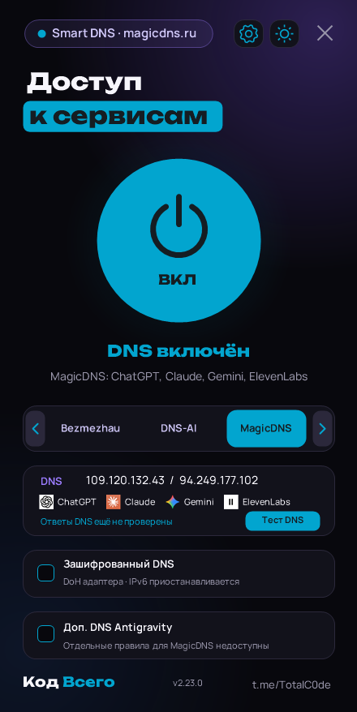
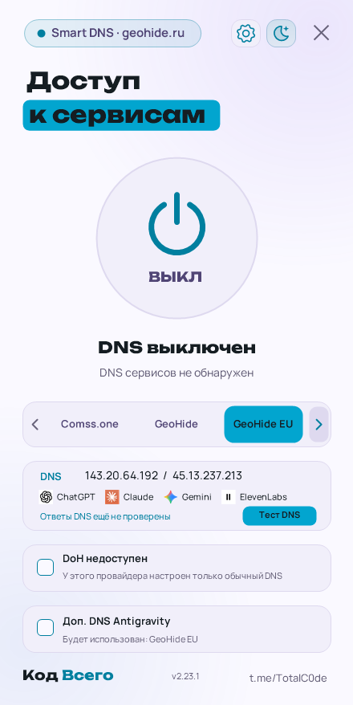

> Доступна [тестовая Windows-версия 2.23.6-test.28](https://github.com/Kam300/KodVsego-SmartDNS/releases/tag/v2.23.6-test.28): новые DNS, локальный режим, DoT, обновлённый выбор подключения и проверки доступности. Функция ключа Gemini удалена из интерфейса и кода. [Изменения](docs/releases/2.23.6-test.28.md). Стабильная версия ниже остаётся 2.23.5.

> В Windows 2.23.6-test.18 в локальном режиме возвращён отдельный переключатель Antigravity: два API-домена можно направить через отдельный DoH-провайдер. Настройка DNS и реальный ответ Antigravity отображаются как разные вещи; общий DNS не считается подтверждением доступа.

> В Windows 2.23.6-test.19 способы подключения разделены: «Через Windows», [«Через приложение»](docs/LOCAL-DNS.md) и экспериментальный «Gemini / NotebookLM». Способ и шифрование выбираются в общей карточке на главном экране; пояснения показаны в списках. Режим «Через приложение» использует loopback `127.0.0.1` / `::1` и отдельный процесс восстановления.

> В Windows 2.23.6-test.16 добавлена [автоматическая проверка фактического DNS](docs/RESOLVER-CHECK.md): после подключения системный путь сравнивается с контрольным через MangoProxy. Результат доступен на главном экране, в «Тест DNS» и журнале; автопроверка отключается в настройках.

> GeoHide и GeoHide EU временно отключены в Windows 2.23.5 и Android 1.5.1. Доступность провайдеров для ПК и Android управляется общим файлом [providers.json](config/providers.json).

# Код Всего · Smart DNS

Переключатель Smart DNS для **компьютеров Windows и телефонов Android**. Выбор провайдера, обычный или зашифрованный DNS, тест доступности и значки сервисов: ChatGPT, Claude, Gemini, ElevenLabs и Spotify.

Начиная с Windows 2.23.2 основной установщик — **MSI** с ярлыком и удалением через настройки Windows. **Портативный ZIP** содержит приложение без установки, а отдельный **EXE** сохраняется для совместимости с обновлениями. [Различия, сборка и удаление](docs/DISTRIBUTION.md).

Перед установкой или обновлением через [MSI](docs/MSI.md) закройте работающую копию Smart DNS. MSI-копия обновляется новым MSI; встроенная проверка открывает страницу релиза.

MSI 2.23.5 при удалении восстанавливает DNS, DoH, IPv6 и изменения правил Antigravity, затем очищает настройки программы и кэш. При ошибке оставшиеся резервные копии сохраняются и удаление останавливается. Обновление через MSI очистку не запускает. [Как устроена очистка](docs/MSI.md).

| Windows · MSI 2.23.5 | Android · APK 1.5.1 |
| :---: | :---: |
| <a href="https://github.com/Kam300/KodVsego-SmartDNS/releases/download/v2.23.5/KodVsego_SmartDNS.Setup.2.23.5.msi"></a> | <a href="https://github.com/Kam300/KodVsego-SmartDNS/releases/download/android-v1.5.1/KodVsego-SmartDNS-Android-1.5.1.apk"></a> |

| Платформа | Скачать | Требования |
| --- | --- | --- |
| Windows · установщик MSI 2.23.5 | [Скачать MSI](https://github.com/Kam300/KodVsego-SmartDNS/releases/download/v2.23.5/KodVsego_SmartDNS.Setup.2.23.5.msi) | Windows 10 2004+ / Windows 11, x64, .NET Framework 4.8 |
| Windows · портативный ZIP 2.23.5 | [Скачать ZIP](https://github.com/Kam300/KodVsego-SmartDNS/releases/download/v2.23.5/KodVsego_SmartDNS.Portable.2.23.5.zip) | Те же требования; распаковать и запустить |
| Windows · отдельный EXE 2.23.5 | [Скачать EXE](https://github.com/Kam300/KodVsego-SmartDNS/releases/download/v2.23.5/KodVsego_SmartDNS.2.23.5.exe) | Windows 10 2004+ / Windows 11, .NET Framework 4.8 |
| Android · APK 1.5.1, предварительная версия | [Скачать APK](https://github.com/Kam300/KodVsego-SmartDNS/releases/download/android-v1.5.1/KodVsego-SmartDNS-Android-1.5.1.apk) | Android 8.0+, без root |

[Канал «Код Всего» — @TotalC0de](https://t.me/TotalC0de) · [Поддержка — @TotalCodeAdmin](https://t.me/TotalCodeAdmin) · [Сообщить об ошибке](https://github.com/Kam300/KodVsego-SmartDNS/issues)

Smart DNS может помочь с доступом к сервисам, поддерживаемым выбранным оператором. **Успешный DNS-ответ не гарантирует открытие сайта, доступ к аккаунту, обход региональной ошибки или работу Gemini.** Набор сервисов зависит от провайдера и может меняться. IP-адрес подключения к сайту приложение не скрывает.

Ссылка канала содержит цифру **0**: https://t.me/TotalC0de. Поддержка — отдельный аккаунт @TotalCodeAdmin.

**Windows 2.23.5:** отменена автоматическая подстройка DNS при смене сети и фоновое восстановление адаптеров. DNS меняется и восстанавливается по действию пользователя, как до test.3. Сохранены исправления DoH и интерфейса Antigravity. GeoHide и GeoHide EU временно отключены. Доступны установщик MSI, портативный ZIP и отдельный EXE. [Изменения выпуска](docs/releases/2.23.5.md). Режим [«Авто»](docs/AUTO.md) остаётся **beta (нестабильный)**. Android 1.5.1 остаётся отдельной предварительной версией; новый APK в этот Windows-релиз не входит.

Кнопка смены темы обновлена: векторные солнце и полумесяц со звездой, голубая подложка и отклик на наведение/нажатие.

## Интерфейс 2.23 / Android 1.4

Тёмная тема с голубыми акцентами (#02A5CF), фиолетовым свечением и ссылкой канала внизу окна; на Windows большой баннер канала убран. Светлая тема сохранена; сделанный ранее выбор темы не сбрасывается. На Windows плавно меняются тема, состояние кнопки питания, положение выбранного провайдера и прокрутка списка. На Android анимируются состояние и нажатие кнопки, появление экрана и смена карточки сервисов; диалоги следуют теме приложения.

В состоянии покоя постоянной анимации нет. Windows останавливает кадровый таймер и кэширует фон; Android переиспользует шрифты/иконки и обновляет элементы только при изменении состояния. Анимации учитывают системное отключение эффектов. Bezmezhau отображает ChatGPT, Gemini и Spotify; список сервисов и тестовые домены согласованы на обеих платформах.

 

На скриншотах показано тестовое состояние интерфейса, без изменения DNS компьютера.

## На компьютере — Windows

1. Скачайте MSI из Releases и установите программу. Для запуска без установки выберите ZIP или отдельный EXE.
2. Выберите DNS-провайдера. В карточке показаны адреса и логотипы сервисов.
3. При необходимости включите «Зашифрованный DNS» или отдельные настройки Antigravity.
4. Нажмите включение и подтвердите UAC. Затем полностью перезапустите браузер или нужное приложение.
5. Для восстановления исходных настроек выключите DNS в приложении.

Приложение сохраняет исходные настройки каждого адаптера до первой записи, поддерживает откат и отложенное восстановление отключённых адаптеров. Изменения выполняются штатными Windows API в короткоживущем процессе с повышением прав. Интерфейс работает с обычными правами. Есть светлая/тёмная тема, проверка сети/VPN, тест DNS, перезапуск браузера с профилями и сохраняемый диагностический отчёт.

Системный DoH требует поддерживаемой Windows 11. В этом режиме сохраняются параметры шифрования и привязки IPv6 для последующего восстановления. [Инструкция Windows и ограничения](docs/WINDOWS.md).

## На телефоне — Android

**Выпущена Android 1.5.1:** обновлён DNS-AI, MagicDNS поддерживает обычный DNS и DoH с проверками Antigravity; GeoHide и GeoHide EU временно отключены. Провайдеры и домены проверок берутся из общего каталога. 88 тестов прошли, Android Lint release — без замечаний. APK подписан прежним ключом; пакет и схема настроек сохранены. Установка поверх 1.5.0 и смена сетей на реальном телефоне не проверены. [Описание релиза](https://github.com/Kam300/KodVsego-SmartDNS/releases/tag/android-v1.5.1) · [Проверки выпуска](android/RELEASE_1.5.1.md).

Начиная с Android 1.5.0 приложение автоматически проверяет GitHub при открытии или возвращении на экран (не чаще раза в час). Для нового APK появляется окно **«Доступно обновление» → «Обновить» / «Позже»**. Есть ручная кнопка «Проверить обновления». Загрузка начинается после согласия, установка подтверждается системным окном Android. [Как работают обновления и как выпускать APK](android/UPDATES.md).

**Первый переход с 1.4.1 и более старых версий на актуальный APK нужно установить вручную**: в старых APK этой функции ещё нет.

1. Скачайте `KodVsego-SmartDNS-Android-1.5.1.apk` из [Android-релиза](https://github.com/Kam300/KodVsego-SmartDNS/releases/tag/android-v1.5.1).
2. Откройте APK и разрешите установку из выбранного источника, если Android попросит.
3. Выберите провайдера, обычный DNS или DoH и нажмите «Включить DNS».
4. Подтвердите системный запрос VPN. Для постоянного отображения состояния разрешите уведомления.
5. Полностью перезапустите нужное приложение. Отключить DNS можно в приложении, уведомлении или виджете.
6. Если окно добавления не появляется, выберите «Как добавить вручную»: удерживайте пустое место рабочего стола → «Виджеты» → «Код Всего · Smart DNS».
7. Нажмите «Добавить виджет» и выберите компактный 2×1 или расширенный 4×2. Также можно добавить виджет «Код Всего» через меню рабочего стола.

Android-версия использует **локальный DNS-туннель через VpnService**. В него направляются только запросы к виртуальному DNS-адресу; трафик сайтов идёт напрямую через Wi-Fi или мобильную сеть. Есть обработка DNS по UDP и TCP, основной/резервный сервер для обычного DNS, DoH через HTTPS с HTTP/2, тест каждого сервера и два виджета рабочего стола. Значки встроены в APK, тема и выбор сохраняются на телефоне.

Особенности Android:

- Другой VPN одновременно использовать нельзя: Android предоставляет один VPN-слот на профиль. Перед заменой приложение показывает подтверждение.
- Строгий «Частный DNS» Android нужно вручную переключить на «Автоматически» или «Выкл.». Настройки Android приложение не переписывает.
- Собственный Secure DNS браузера и встроенные DNS-клиенты приложений могут обходить настройку.
- DoH не переходит на обычный DNS при ошибке HTTPS. Это защита DNS-запросов, а не шифрование всего интернет-трафика. Имя самого DoH endpoint определяется через физическую сеть.
- IPv6-трафик сайтов остаётся прямым; A и AAAA запросы обслуживаются через локальный IPv4 DNS. Принудительного отключения IPv6 нет.
- Windows NRPT, реестр, UAC и принудительный перезапуск чужих приложений на Android не используются.
- Always-on, запуск при загрузке и режим «Блокировать соединения без VPN» не поддерживаются. После остановки туннеля Android возвращает DNS физической сети.

**В Android 1.2.0** исправлены возврат из фона и отключение: состояние анимаций сбрасывается при возобновлении, а закрытие сетевых ресурсов выполняется вне потока интерфейса. Отменённое подключение не может позднее включить VPN. Учтены отступы системных панелей, удалены настройки и маршрутизация Antigravity. Кнопки виджетов отключают службу напрямую; включение открывает приложение для системного согласия VPN.

**В Android 1.3.0** выбор провайдера открывается в нижней панели с карточками, списком сервисов и отметкой текущего DNS. Увеличены отступы между действиями, скрыта полоса прокрутки и убран блок «Как работает на телефоне». Виджеты и сетевые настройки доступны отдельными кнопками. При нажатии на старт появляется короткая голубая волна, во время подключения — вращающийся индикатор.

**Статус Android 1.5.1:** предварительная версия. Ядро, возврат из фона, клики, остановка и действия виджетов проверяются JUnit/Robolectric (Android 9 и 15), сборка — Android Lint. Подключённого телефона/эмулятора при разработке не было: системный диалог VPN, смена Wi-Fi/мобильной сети и реальный TUN на устройстве ещё требуют проверки. Это не подтверждение работоспособности на всех телефонах. [Устройство Android-версии и сборка](android/README.md).

## Провайдеры

| Провайдер | Обычный DNS IPv4 | DoH |
| --- | --- | --- |
| Comss.one | `83.220.169.155`, `212.109.195.93` | `https://dns.comss.one/dns-query` |
| GeoHide (отключён) | `159.194.200.33`, `193.233.112.67` | `https://geohide.ru/dns-query` |
| GeoHide EU (отключён) | `143.20.64.192`, `45.13.237.213` | Нет настроенного endpoint |
| Bezmezhau | `143.20.64.55`, `31.58.216.201` | `https://dns.bezmezhau.com/dns-query` |
| MagicDNS | `109.120.132.43`, `94.249.177.102` | `https://dns.magicdns.ru/dns-query` |
| DNS-AI | Только DoH; Windows использует `194.87.196.13`, `45.151.102.219` | `https://dns.dns-ai.ru/dns-query` |

Для системного DoH Comss на Windows используется отдельный адрес `195.133.25.16`; Android отправляет DNS непосредственно на HTTPS endpoint. DNS-AI работает только через DoH на обеих платформах. В Windows 2.23.5 отдельные правила Antigravity доступны для MagicDNS и Bezmezhau. Шифрованное подключение Antigravity выполняется через общий DoH, без дополнительных правил. GeoHide и GeoHide EU скрыты из выбора, но их адреса сохранены для восстановления прежних настроек.

Параметры MagicDNS и заявленная поддержка Antigravity сверены с [официальной инструкцией](https://magicdns.ru/) 23 октября 2026 года. Сервисы указаны по данным оператора; доступность из каждой сети не подтверждена. Остальные адреса и описания сервисов перенесены из Windows-версии. Таблица не является результатом новой проверки доступности операторов. При выборе стороннего DNS вы доверяете его оператору разрешение доменных имён.

## Сборка из исходников

### Windows

```bat
build.bat
```

Результат из текущих исходников: `KodVsego_SmartDNS.2.23.5.exe`. Используется системный компилятор .NET Framework; зависимости не скачиваются. Готовый релиз собирается через `build-distribution.ps1` с проверенным Microsoft Roslyn; [состав пакетов и проверки](docs/DISTRIBUTION.md).

```powershell
powershell -NoProfile -ExecutionPolicy Bypass -File tests\run.ps1
```

Отдельные проверки поиска DLL: `tests/ProcessSecurity.Tests.cs`. Превью интерфейса без переключения DNS: `preview.ps1`.

Проверка реальных переходов окна и отключения кадрового таймера: `powershell -NoProfile -ExecutionPolicy Bypass -File tests\UiMotion.Tests.ps1`. Скрипт не вызывает изменение DNS; окно находится за пределами экрана.

### Android

Установите JDK 17 и Android SDK Platform 35 / Build Tools 34.0.0. Создайте `android/local.properties` с `sdk.dir=путь/к/Android/Sdk` или задайте `ANDROID_HOME`.

```powershell
cd android
.\gradlew.bat testDebugUnitTest lintDebug assembleDebug
```

Linux/macOS: `bash gradlew testDebugUnitTest lintDebug assembleDebug`. APK для разработки находится в `android/app/build/outputs/apk/debug/app-debug.apk`. Для подписанного выпуска настройте собственный ключ по [инструкции](android/README.md#подпись-apk). Ключи и пароли не хранятся в Git.

[GitHub Actions](.github/workflows/build.yml) собирает Windows EXE и Android debug APK, запускает тесты и Lint. Сборочные файлы публикуются как артефакты CI; пользовательские подписанные APK — в Releases.

## Структура

- `XboxDns.cs`, `StyledDialog.cs` — Windows UI и логотипы сервисов.
- `NativeDns.cs`, `EncryptedDns.cs`, `DnsElevation.cs` — системные DNS Windows, резервные копии, DoH и UAC.
- `AntigravityDns.cs`, `AgTakeover.cs`, `AgCleanup.cs` — правила Antigravity на Windows.
- `android/app/src/main/java/ru/kodvsego/smartdns/` — Android UI, VPN-служба, DNS и HTTPS-транспорт.
- `res/power.svg` и Android `ic_power.xml` — векторный значок питания.
- `tests/` и `android/app/src/test/` — проверки платформ.
- `res/service-icons/` — общие логотипы Windows/Android и сведения об источниках.
- `docs/WINDOWS.md` — актуальная инструкция Windows и ограничения.

## Конфиденциальность и лицензия

Изменения в текущей версии: © 2026 «Код Всего». Исходное уведомление HB AI и условия MIT сохранены в [LICENSE](LICENSE); лицензии шрифтов — в `res/OFL-Unbounded.txt` и `res/OFL-Manrope.txt`.

Android-приложение не сохраняет историю DNS-запросов, не читает аккаунты и файлы других приложений и не отправляет диагностические отчёты автоматически. DNS-запросы получает выбранный DNS-оператор. У Windows-версии диагностический TXT создаётся по запросу пользователя; автоматической отправки нет.

Проект основан на [hb-ai-xbox-dns](https://github.com/neiroseti-ai/hb-ai-xbox-dns/) и распространяется по [MIT](LICENSE), [русский текст](LICENSE.ru.md). Исходные уведомления сохранены. Логотипы принадлежат соответствующим правообладателям, [источники](res/service-icons/README.md). Шрифты Windows — SIL OFL 1.1. Android-зависимости — [Apache 2.0](android/app/src/main/assets/third-party/NOTICE.txt).
